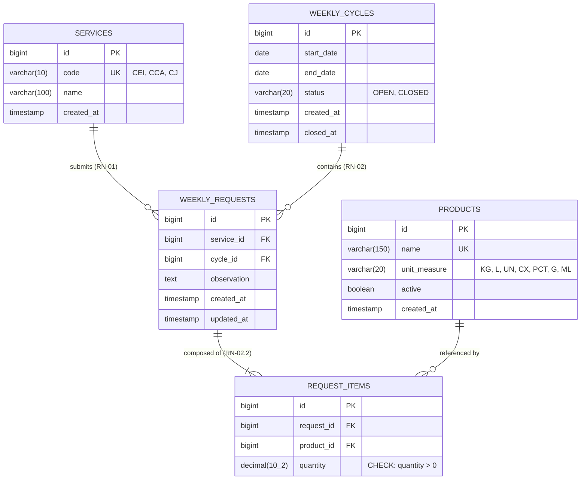

# Consolida IAG — Back-end Architecture & API Contracts

## Purpose

This rule defines the official technical architecture, relational database schema, and REST API contracts for the **Consolida IAG Back-end**.

Any data model, migration, entity mapping, endpoint implementation, or unit/integration test created by the Agent **MUST** follow these contracts and integrity constraints.

---

## 1. Relational Database Schema (SQL Modeling)

The persistence layer guarantees data integrity, domain isolation per service (RN-01), and non-destructive consolidation (RN-03).

### 1.1 Entity-Relationship Diagram (Mermaid)



### 1.2 Table Definitions and Constraints

#### Table `services`

* `id`: BIGINT AUTO_INCREMENT (or UUID) PRIMARY KEY.
* `code`: VARCHAR(10) NOT NULL UNIQUE (Valid values: `'CEI'`, `'CCA'`, `'CJ'`).
* `name`: VARCHAR(100) NOT NULL.
* `created_at`: TIMESTAMP DEFAULT CURRENT_TIMESTAMP NOT NULL.

#### Table `products`

* `id`: BIGINT AUTO_INCREMENT PRIMARY KEY.
* `name`: VARCHAR(150) NOT NULL UNIQUE.
* `unit_measure`: VARCHAR(20) NOT NULL (e.g., `'KG'`, `'L'`, `'UN'`, `'CX'`, `'PCT'`, `'G'`, `'ML'`).
* `active`: BOOLEAN DEFAULT TRUE NOT NULL.
* `created_at`: TIMESTAMP DEFAULT CURRENT_TIMESTAMP NOT NULL.

#### Table `weekly_cycles`

* `id`: BIGINT AUTO_INCREMENT PRIMARY KEY.
* `start_date`: DATE NOT NULL.
* `end_date`: DATE NOT NULL.
* `status`: VARCHAR(20) NOT NULL DEFAULT `'OPEN'` (CHECK: `status IN ('OPEN', 'CLOSED')`).
* `created_at`: TIMESTAMP DEFAULT CURRENT_TIMESTAMP NOT NULL.
* `closed_at`: TIMESTAMP NULL.

#### Table `weekly_requests` (or `requests`)

* `id`: BIGINT AUTO_INCREMENT PRIMARY KEY.
* `service_id`: BIGINT NOT NULL, FK referencing `services(id)`.
* `cycle_id`: BIGINT NOT NULL, FK referencing `weekly_cycles(id)`.
* `observation`: TEXT NULL (free-text for specific non-cataloged needs — RN-02.3).
* `created_at`: TIMESTAMP DEFAULT CURRENT_TIMESTAMP NOT NULL.
* `updated_at`: TIMESTAMP DEFAULT CURRENT_TIMESTAMP ON UPDATE CURRENT_TIMESTAMP NOT NULL.
* **Integrity Constraint:** `CONSTRAINT uq_service_cycle UNIQUE (service_id, cycle_id)` — *Enforces RN-02.4 (maximum 1 request per service per cycle).*

#### Table `request_items`

* `id`: BIGINT AUTO_INCREMENT PRIMARY KEY.
* `request_id`: BIGINT NOT NULL, FK referencing `weekly_requests(id)` ON DELETE CASCADE.
* `product_id`: BIGINT NOT NULL, FK referencing `products(id)`.
* `quantity`: DECIMAL(10, 2) NOT NULL (CHECK: `quantity > 0` — RN-02.2).
* **Integrity Constraint:** `CONSTRAINT uq_request_product UNIQUE (request_id, product_id)` — *Guarantees no duplicate product lines within the same request.*

---

## 2. REST API Contract (Endpoints & Payloads)

Base prefix: `/api/v1`

### 2.1 Product Catalog

* **`GET /api/v1/products`** (alias: `/api/v1/produtos`)
  * Returns list of active catalog products with their respective unit of measure.
  * Response (200 OK):

    ```json
    [
      { "id": 1, "name": "Long Grain White Rice", "unit_measure": "KG", "active": true },
      { "id": 2, "name": "Pinto Beans", "unit_measure": "KG", "active": true },
      { "id": 3, "name": "Soybean Oil", "unit_measure": "L", "active": true }
    ]
    ```

* **`POST /api/v1/products`** (alias: `/api/v1/produtos`)
  * Registers a new product in the catalog (active by default).
  * Request Payload:

    ```json
    {
      "name": "Powdered Whole Milk",
      "unit_measure": "KG"
    }
    ```

  * Response (201 Created):

    ```json
    {
      "id": 4,
      "name": "Powdered Whole Milk",
      "unit_measure": "KG",
      "active": true
    }
    ```

### 2.2 Weekly Cycles

* **`POST /api/v1/cycles`** (alias: `/api/v1/ciclos`)
  * Opens a new weekly cycle with `status = 'OPEN'`.
  * Request Payload:

    ```json
    {
      "start_date": "2026-09-08",
      "end_date": "2026-09-14"
    }
    ```

  * **Validation (RN-02.8):** At most one cycle may hold `status = 'OPEN'` simultaneously. If an open cycle already exists, rejects with `409 Conflict` `{ "error": "An active open cycle already exists." }`.
  * Response (201 Created):

    ```json
    {
      "id": 13,
      "start_date": "2026-09-08",
      "end_date": "2026-09-14",
      "status": "OPEN",
      "created_at": "2026-09-08T08:00:00Z"
    }
    ```

* **`GET /api/v1/cycles/active`** (alias: `/api/v1/ciclos/ativo`)
  * Returns the current weekly cycle with `status = 'OPEN'`.
  * Response (200 OK):

    ```json
    {
      "id": 12,
      "start_date": "2026-09-01",
      "end_date": "2026-09-07",
      "status": "OPEN"
    }
    ```

  * If no open cycle exists: `404 Not Found` `{ "error": "No open weekly cycle found at this time." }`.

* **`GET /api/v1/cycles`** (alias: `/api/v1/ciclos`)
  * Supports query parameter `?status=CLOSED` for historical query (RN-04.3).
  * Returns list of cycles ordered by start date descending.

* **`POST /api/v1/cycles/{id}/close`** (alias: `/api/v1/ciclos/{id}/fechar`)
  * Closes the active cycle and sets `status = 'CLOSED'` and `closed_at = CURRENT_TIMESTAMP`.
  * Permanently locks all associated requests and items against future modification (RN-02.5). Reopening a closed cycle is strictly forbidden (out of scope).
  * Does not require all 3 services to have submitted; missing services are treated as zero quantity (RN-02.7).

### 2.3 Weekly Request Submission by Service

* **`POST /api/v1/requests`** (alias: `/api/v1/solicitacoes`)
  * Submits the weekly purchase request for a cost center service (`CEI`, `CCA`, or `CJ`).
  * Request Payload:

    ```json
    {
      "service_code": "CEI",
      "observation": "Need 2 extra boxes of matches.",
      "items": [
        { "product_id": 1, "quantity": 20.0 },
        { "product_id": 2, "quantity": 15.0 }
      ]
    }
    ```

  * Response (201 Created):

    ```json
    {
      "id": 105,
      "service_code": "CEI",
      "cycle_id": 12,
      "created_at": "2026-09-02T10:15:30Z"
    }
    ```

* **`PUT /api/v1/requests/{id}`** (alias: `/api/v1/solicitacoes/{id}`)
  * Updates an existing request while its associated cycle holds `status = 'OPEN'` (RN-02.6).
  * Replaces line items and observation atomically.
  * If the associated cycle has `status = 'CLOSED'`, rejects with `422 Unprocessable Entity` (RN-02.5).

  * **Mandatory Back-end Validations:**
    1. An active cycle must exist and have `status = 'OPEN'` (RN-02.5).
    2. The service must not have already submitted a request for the active cycle, unless updating an existing request via `PUT` (RN-02.4, RN-02.6).
    3. At least one item must have `quantity > 0` (RN-02.2).
    4. All `product_id` references must point to active products (RN-02.1).
    5. Quantities accept standard decimal precision (`DECIMAL(10, 2)`) uniformly across all catalog units.

### 2.4 Reports & Projections (Wholesale & Fiscal Reconciliation)

* **`GET /api/v1/cycles/{id}/consolidated`** (alias: `/api/v1/ciclos/{id}/consolidado`)
  * Real-time computed sum of requested products across all participating services for wholesale supplier negotiation (RN-03.1).
  * Response (200 OK):

    ```json
    {
      "cycle_id": 12,
      "status": "OPEN",
      "items": [
        {
          "product_id": 1,
          "name": "Long Grain White Rice",
          "unit_measure": "KG",
          "total_quantity": 60.0,
          "breakdown_by_service": [
            { "service_code": "CEI", "quantity": 20.0 },
            { "service_code": "CCA", "quantity": 15.0 },
            { "service_code": "CJ", "quantity": 25.0 }
          ]
        }
      ]
    }
    ```

* **`GET /api/v1/cycles/{id}/services/{service_code}`** (alias: `/api/v1/ciclos/{id}/servicos/{servico_id}`)
  * Returns the isolated items and observations for a specific cost center to reconcile physical invoice delivery (RN-04.2).
  * Response (200 OK):

    ```json
    {
      "cycle_id": 12,
      "service": { "code": "CEI", "name": "Early Childhood Education Center" },
      "observation": "Need 2 extra boxes of matches.",
      "items": [
        { "product_id": 1, "name": "Long Grain White Rice", "unit_measure": "KG", "quantity": 20.0 },
        { "product_id": 2, "name": "Pinto Beans", "unit_measure": "KG", "quantity": 15.0 }
      ]
    }
    ```

---

## 3. Technical Implementation Guidelines

1. **Transactional Atomicity:** Request creation with its nested line items must execute within an atomic database transaction (`BEGIN ... COMMIT` / `@Transactional`).
2. **Efficient SQL Aggregation:** Consolidation must use SQL aggregation (`SUM(quantity) ... GROUP BY product_id`) for dynamic computation without redundant storage.
3. **Standardized Error Responses:** Validation failures and business exceptions must return `400 Bad Request` or `422 Unprocessable Entity` with the format `{ "error": "DESCRIPTION", "details": [...] }`.
